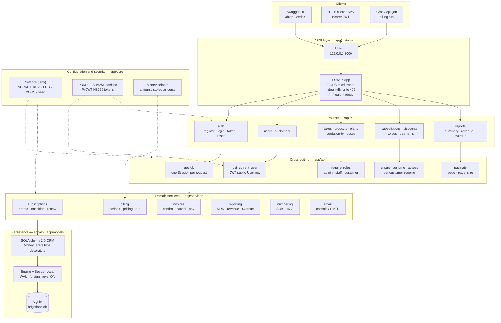
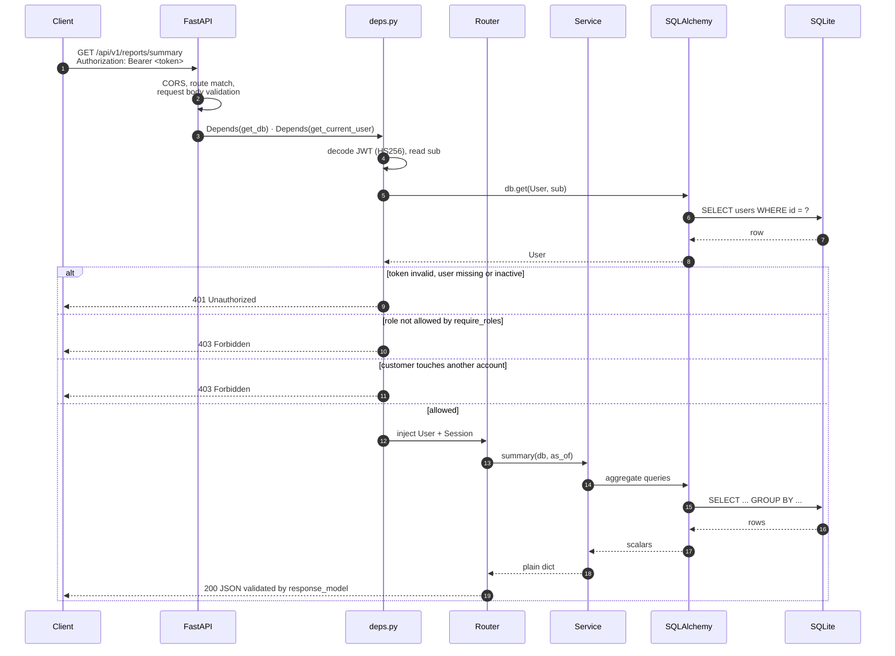
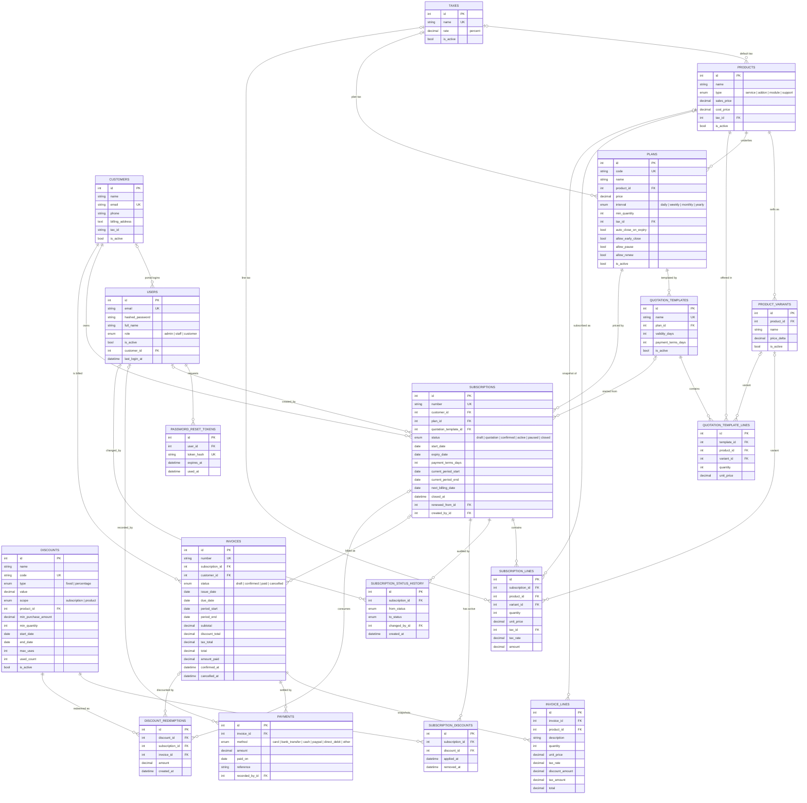
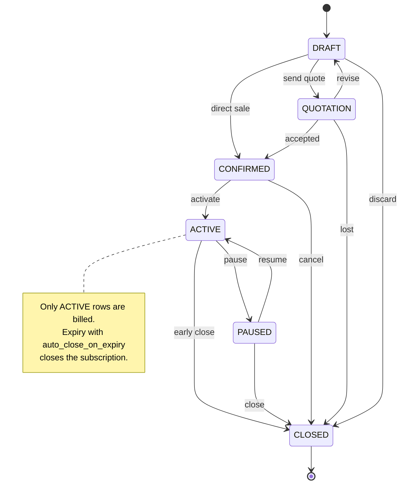
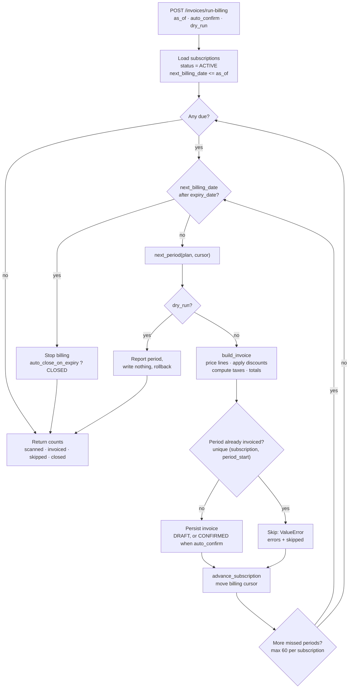

# Backend architecture

Brightloop Subscription Management API — FastAPI + SQLAlchemy 2 + SQLite.
This document is the map of the running system: layers, request flow, data
model, subscription lifecycle and the billing run.

> Mermaid diagrams render on GitHub, GitLab and in the VS Code Markdown
> preview (extension: *Markdown Preview Mermaid Support*).

---

## 1. Layered architecture



**Rules of the layers**

| Layer | Owns | Must not |
| --- | --- | --- |
| `app/api/v1/*` | HTTP verbs, status codes, auth gates, response models | contain pricing or state-machine logic |
| `app/api/deps.py` | token decoding, role checks, customer scoping, pagination | touch domain tables beyond `users` |
| `app/services/*` | business rules, transactions, calculations | import FastAPI or raise `HTTPException` |
| `app/models/*` | schema, relationships, enums, cheap `@property` helpers | perform I/O |
| `app/schemas/*` | request/response contracts and validation | import services |

---

## 2. Request lifecycle



Notes:

* The **role is read from the database on every request**, not trusted from the
  token claim, so demotions and `is_active = false` take effect immediately.
* `IntegrityError` is translated once, globally, into `409 Conflict`
  (`app/main.py`).
* Every route writes through one `Session`; services never commit, routers do.

---

## 3. Data model



Key constraints:

* `invoices (subscription_id, period_start)` is **unique** — the hard guarantee
  that a billing period is never invoiced twice.
* `subscriptions.expiry_date` + `next_billing_date` drive the billing cursor.
* `discounts.used_count` guards `max_uses`; rows in `discount_redemptions` are
  written only when an invoice is confirmed.
* Money is stored as integer cents (`Money`) and tax rates as basis points
  (`Rate`); API payloads use decimal numbers.

---

## 4. Subscription lifecycle



Transitions are declared once in `app/models/subscription.py`
(`STATUS_TRANSITIONS`) and enforced by `app/services/subscriptions.py`; an
invalid move raises `ValueError`, which the router maps to `409`.

`activate` sets `current_period_start` / `current_period_end` /
`next_billing_date`, so the first billing run can pick the subscription up.

---

## 5. Billing run

`POST /api/v1/invoices/run-billing` (admin or staff) → `run_billing()`.



Behaviour worth knowing:

* **Catch-up billing**: a subscription that was offline for months produces one
  invoice per missed period, capped at `max_cycles = 60`.
* **Idempotent**: re-running for the same `as_of` never duplicates invoices.
* **Dry run** rolls the whole transaction back and returns what *would* happen.
* Discounts are re-evaluated at invoice time against their date window,
  minimum quantity/amount and remaining `max_uses`.

---

## 6. Module map

```
app/
  main.py              FastAPI app, lifespan (create_all + seed), CORS, 409 handler
  core/
    config.py          env-driven Settings
    security.py        PBKDF2 hashing, JWT encode/decode, password policy
    money.py           cents/Decimal helpers
  db/
    base.py            Declarative Base, TimestampMixin, Money, Rate, enum_column
    session.py         engine, SQLite PRAGMAs, SessionLocal, get_db
    seed.py            demo users, customers, catalogue, subscriptions, invoices
  models/              users/customers, products/taxes, plans, quotations,
                       discounts, subscriptions, invoices/payments
  schemas/             Pydantic request/response contracts
  services/            subscriptions, billing, invoices, reporting, numbering, email
  api/
    deps.py            auth, role gates, pagination, customer scoping
    pagination.py      page/page_size helpers
    v1/                one router per resource, wired in v1/router.py
docs/
  architecture.md      this document
tests/                 pytest suite against an in-memory SQLite database
```

Runtime entry point: `uvicorn app.main:app --reload` — API under `/api/v1`,
docs at `/docs`, health at `/health`.
